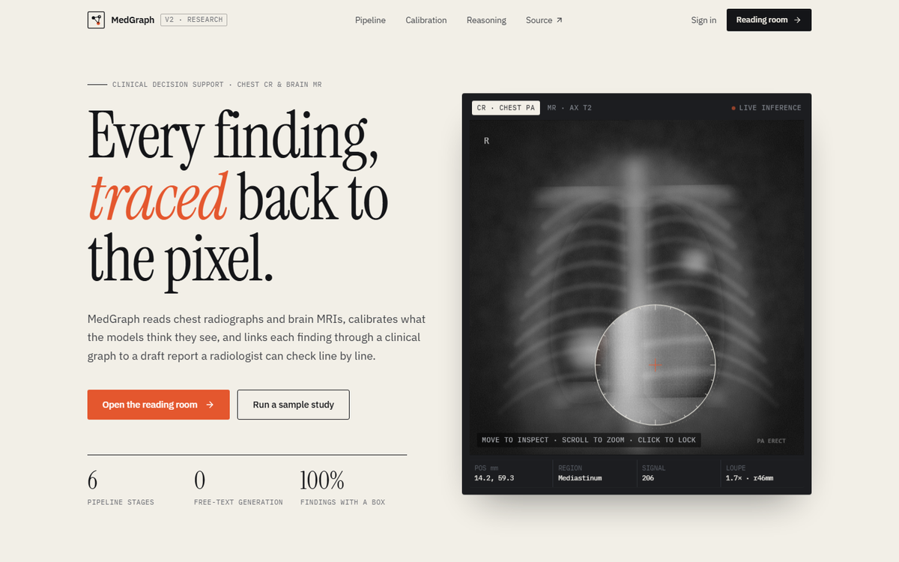
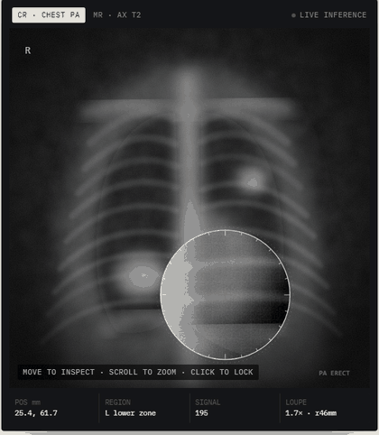
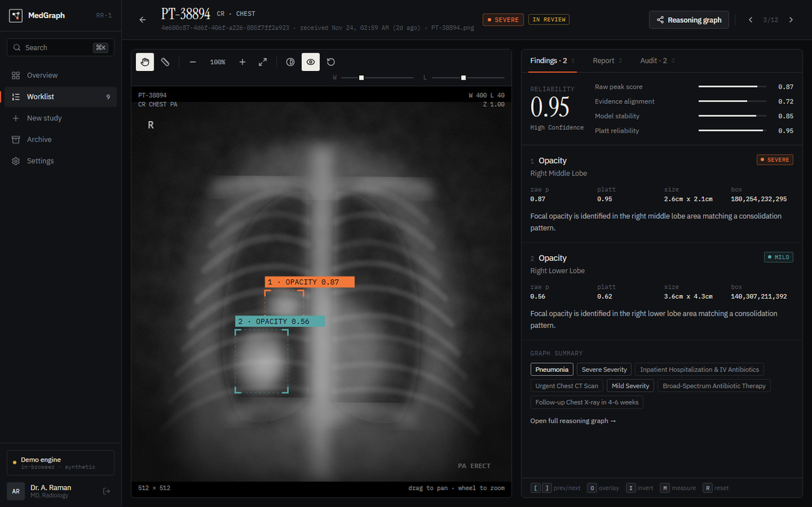
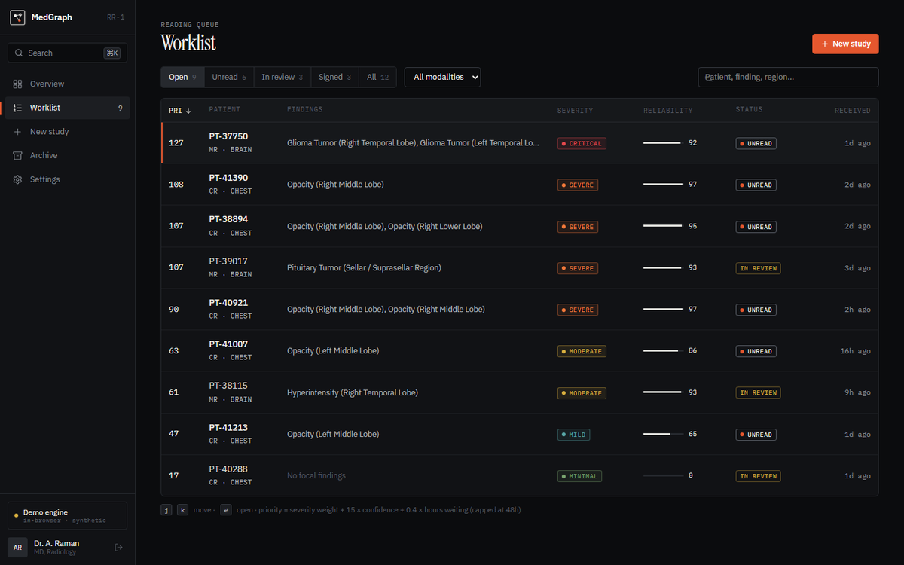
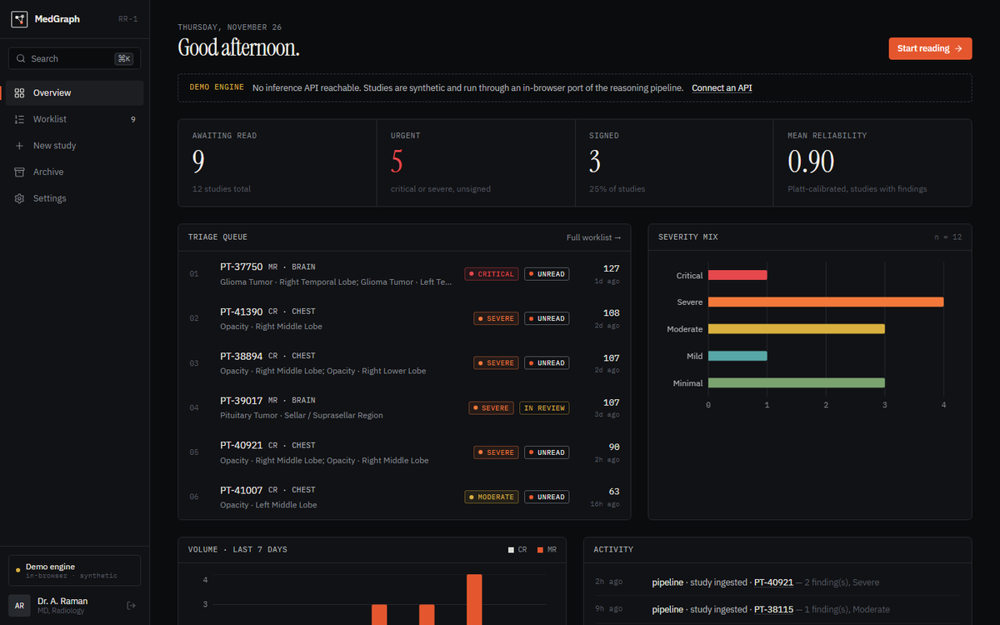
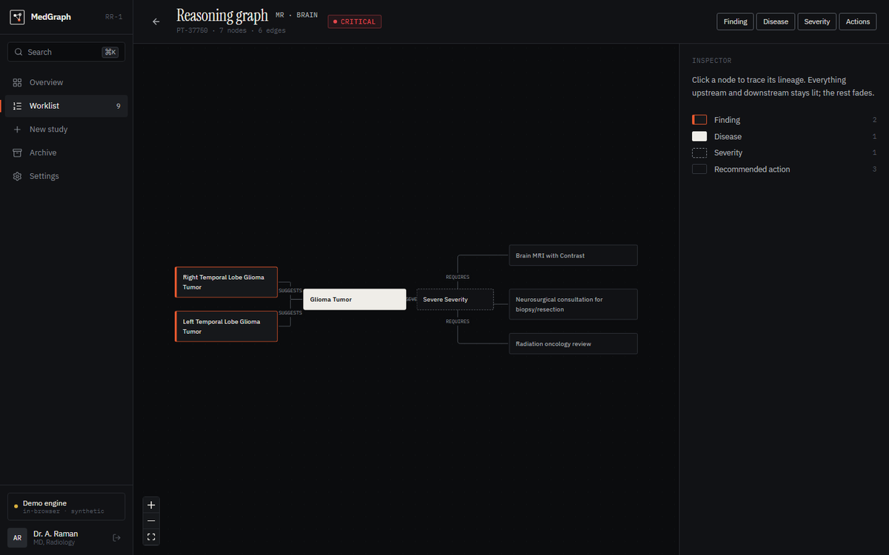
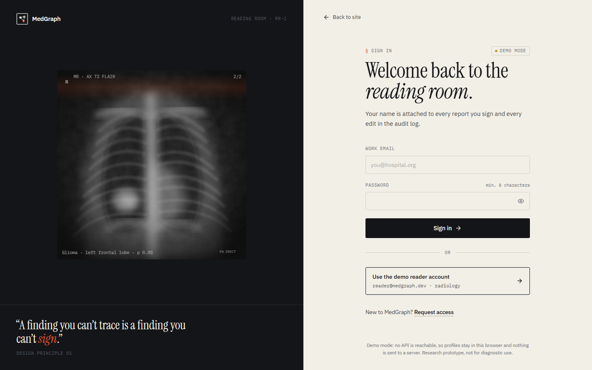

# MedGraph AI 🧠🩻

[](https://github.com/sroshans025/medgraph/actions/workflows/ci.yml)


> **Explainable Clinical Decision Support System for Medical Imaging**

<p align="center">
  
</p>

MedGraph AI is a premium, end-to-end clinical decision support platform that combines Deep Learning vision models (YOLO & MONAI U-Net) with a clinical knowledge graph and reasoning engine to provide explainable diagnostic reports for Chest X-Rays and Brain MRIs.

---

## 📸 Screenshots

<table>
  <tr>
    <td width="42%"><br><sub><b>Landing hero.</b> The loupe magnifies the film and reveals detections and live readouts.</sub></td>
    <td><br><sub><b>Study viewer.</b> Zoom/pan, window/level, mm ruler, boxes linked to findings, calibration breakdown.</sub></td>
  </tr>
  <tr>
    <td><br><sub><b>Worklist.</b> Priority-sorted triage queue.</sub></td>
    <td><br><sub><b>Overview.</b> KPIs, triage queue, severity mix, volume and activity.</sub></td>
  </tr>
  <tr>
    <td><br><sub><b>Reasoning graph.</b> Findings → differentials → severity → next steps.</sub></td>
    <td><br><sub><b>Sign in.</b> Server accounts when the API is online, demo mode otherwise.</sub></td>
  </tr>
</table>

---

## 🚀 Key Features

*   **Multimodal Image Processing:** Automatically preprocesses and detects the modality of uploaded scans (Chest X-Ray or Brain MRI).
*   **Deep Learning Computer Vision:**
    *   **Chest X-Ray:** Object detection for pathological findings using **Ultralytics YOLOv11**.
    *   **Brain MRI:** Semantic segmentation of lesions using **MONAI U-Net**.
*   **Explainable AI & Clinical Reasoning:**
    *   **Visual Annotations:** Generates scan overlays highlighting detected regions.
    *   **Platt-scaled Confidence Calibration:** Calibrates confidence scores based on modality and model outputs.
    *   **Clinical Knowledge Graph:** Dynamically maps findings, clinical concepts, and next-step recommendations.
    *   **Zero-Hallucination Reasoning Engine:** Synthesizes structured clinical interpretations grounded strictly in model findings.
*   **Versioned Reporting:** Physicians edit drafts as numbered versions with revision notes; signing locks a report, and editing after sign-off reopens it.

---

## 🖥️ Frontend (v2)

The web app is split into a public landing page and a radiology **reading room**.

**Landing page** (`#/`)
*   **Diagnostic loupe hero:** move the cursor over a rendered chest film or brain MRI. The loupe magnifies the region and reveals detections, heat maps and live readouts (position in mm, region, signal). Scroll to resize, click to lock.
*   **Pipeline walkthrough:** the six stages with the structured output each one produces.
*   **Calibration playground:** drag a raw score and the steepness `k` to see the Platt curve and confidence bands the backend uses.
*   **Reasoning trace:** hover any graph node to light up its full lineage.

**Sign in** (`#/login`)
*   Split-screen sign-in with a rotating film panel, show/hide password, validation and a *Request access* mode for new readers.
*   One-click demo account: `reader@medgraph.dev` / `radiology`.
*   Every `#/app` route is guarded and returns you to the page you asked for after sign-in. The reader's name is stamped on report signatures and audit entries.
*   A badge shows whether you are on a **secure server** (real backend accounts) or in **demo mode** (browser-only profile, used when no API is reachable).

**Reading room** (`#/app`)
| View | What it does |
| :--- | :--- |
| Overview | KPIs, triage queue, severity mix, 7-day volume by modality, activity feed |
| Worklist | Priority-sorted queue (severity + confidence + wait time), status filters, `j`/`k` keyboard navigation |
| Study viewer | Zoom/pan, window/level, invert, measurement ruler in mm, detection boxes linked both ways to findings, calibration breakdown |
| Report | Edit → versioned save, sign/reopen, print-to-PDF layout, `.txt` export |
| Audit | Per-study event log and report version history |
| Reasoning graph | React Flow graph with lineage highlighting, node inspector and type filters |
| Archive | Thumbnail grid, side-by-side compare of two studies, CSV export |
| Settings | API URL, reviewer identity, demo toggle, keyboard reference |

`⌘K` opens a command palette for jumping to any patient, study or action.

**Demo engine.** When no API is reachable (for example on the hosted preview, where browsers block `http://localhost` from an `https` page), the app switches to an in-browser port of the reasoning pipeline in `frontend/src/lib/engine.ts`. It applies the same location heuristics, severity grading, Platt calibration, graph rules and report templates as the backend, and runs them on simulated, deterministic vision output over procedurally rendered scans. These are synthetic; no patient data is used. Set `VITE_API_URL` or use Settings to point at a live backend.

---

## 🛠️ Technology Stack

| Component | Technology |
| :--- | :--- |
| **Frontend** | React 19 (TypeScript), Vite, TailwindCSS, Lucide Icons, Recharts, Axios |
| **Backend** | FastAPI, Uvicorn, SQLite, SQLAlchemy (Async), Alembic |
| **ML & AI Engine** | PyTorch, Ultralytics (YOLO), MONAI (U-Net), NetworkX, OpenCV |
| **Containerization** | Docker, Docker Compose |
| **Deployment** | Vercel (Frontend), Custom Python Host (Backend) |

---

## 📁 Repository Structure

```
medgraph-ai/
├── backend/                  # FastAPI Application
│   ├── api/                  # Routes, Router, and Schemas
│   ├── core/                 # Configurations & Environments
│   ├── services/             # Core ML Inference & Post-processing
│   │   ├── models/           # Vision (YOLO/U-Net) & Reasoning Engines
│   │   └── preprocessor.py   # Image Preprocessing Utility
│   └── main.py               # Backend entry point
├── frontend/                 # React Frontend
│   ├── src/                  # React components, pages, and services
│   ├── package.json          # Node dependencies & build scripts
│   └── vite.config.ts        # Vite build tool config
├── training/                 # Model Training & Pipelines
├── tests/                    # Backend Pytest suite
├── docker-compose.yml        # Docker composition setup
├── pyproject.toml            # Python tool configurations & Vercel builds
└── requirements.txt          # Python dependencies
```

---

## 💻 Local Setup

### Prerequisites
*   Python 3.11 or 3.12
*   Node.js 20+

### 1. Backend Setup
Navigate to the root directory and create a virtual environment:
```bash
# Create virtual environment
python -m venv .venv

# Activate virtual environment (Windows)
.venv\Scripts\activate
# Activate virtual environment (macOS/Linux)
source .venv/bin/activate

# Install dependencies
pip install -r requirements.txt

# Run the FastAPI server
python -m backend.main
```
The backend API will be available at **`http://localhost:8000`** with interactive Swagger documentation at **`http://localhost:8000/docs`**.

### 2. Frontend Setup
Navigate to the `frontend` directory:
```bash
cd frontend

# Install Node dependencies
npm install

# Run the frontend in development mode
npm run dev
```
The React frontend will be running at **`http://localhost:5173`**. Sign in with the demo account `reader@medgraph.dev` / `radiology`.

---

## 🔐 Authentication

The backend ships with real reader accounts. There are no extra dependencies; everything is built on the Python standard library.

| | |
| :--- | :--- |
| Passwords | Salted PBKDF2-HMAC-SHA256, 310,000 iterations, compared in constant time |
| Sessions | Signed HS256 bearer tokens with expiry (`JWT_EXPIRE_MINUTES`, default 12 h) |
| Protected | `POST /analyze`, `GET /case/{id}`, `GET /history`, `PATCH /report/{id}`, `GET /overlay/{id}` (also accepts `?token=` so `` tags work) |
| Public | `GET /health`, `GET /models`, `POST /auth/login`, `POST /auth/register` |
| Audit | Report edits record the signed-in reader's email as `editor_id` |

Endpoints: `POST /api/v1/auth/register`, `POST /api/v1/auth/login`, `GET /api/v1/auth/me`. The first account registered on a fresh database becomes `admin`.

Configure it with environment variables (copy `.env.example` to `.env`):

*   `JWT_SECRET`: **set this in production**. Without it, a random key is generated at startup and tokens stop working after a restart. Docker Compose refuses to start until it is set.
*   `AUTH_REQUIRED=false` turns protection off for local experiments.
*   `ALLOW_REGISTRATION=false` closes self-sign-up.
*   `SEED_DEMO_USER=false` removes the demo account. Do this for any deployment that holds real data.

The frontend stores the token in `localStorage`, sends it as `Authorization: Bearer …`, and returns to the sign-in page on any `401`. For a hospital deployment, replace this with your identity provider (OIDC/SAML) and serve the API over HTTPS.

---

## 🌍 Making the hosted preview public

Vercel protects deployments with **Vercel Authentication** by default, so only members of your Vercel team can open them. To share the link publicly: open the project in the Vercel dashboard → **Settings → Deployment Protection** → set **Vercel Authentication** to **Disabled** → **Save**. The next visit to the production URL loads without a Vercel login.

---

## 🐳 Docker Deployment

You can run the entire stack (FastAPI + React Vite + Database) using Docker Compose:

```bash
cp .env.example .env          # then set JWT_SECRET in .env
docker compose up --build
```
The backend runs on port `8000` and the frontend on port `3000`. The SQLite database is kept in the `backend-data` volume, so accounts and cases survive restarts.

---

## ⚡ API Endpoints Quick Reference

| Endpoint | Method | Description |
| :--- | :--- | :--- |
| `/api/v1/analyze` | `POST` | Upload and analyze a scan (form-data: `file`, `patient_id`, `modality_override`) |
| `/api/v1/case/{case_id}` | `GET` | Retrieve case diagnostic details & report |
| `/api/v1/overlay/{case_id}`| `GET` | Get the generated PNG overlay file |
| `/api/v1/history` | `GET` | List all historical cases |
| `/api/v1/report/{case_id}` | `PATCH` | Edit/update report findings (saves to history) |
| `/api/v1/models` | `GET` | List details and versions of registered models |
| `/api/v1/health` | `GET` | Verify api readiness and pipeline health |
| `/api/v1/auth/register` | `POST` | Create a reader account (JSON: `email`, `password`, `name`, `credentials`) |
| `/api/v1/auth/login` | `POST` | Exchange email + password for a bearer token |
| `/api/v1/auth/me` | `GET` | Current reader profile |

Case, history, analyze, report and overlay endpoints require `Authorization: Bearer <token>`.

---

## 🌐 Production Deployment

The frontend and backend deploy separately: the React app as static files on **Vercel**, and the FastAPI service as a Docker container on **Render** (free plan, no card required).

### 1. Backend → Render

One-time setup (about 5 minutes):

1. Sign in at [render.com](https://render.com) with GitHub.
2. **New → Blueprint** → select `sroshans025/medgraph`. Render reads `render.yaml`, which builds `backend/Dockerfile` on the free plan and generates a random `JWT_SECRET`.
3. Click **Apply**. The first build takes about 10 minutes. The API is then live at
   `https://medgraph-api.onrender.com/api/v1/health` (docs at `/docs`; Render may add a suffix to the name if it is taken).

Every push to `main` redeploys automatically.

> Free Render services sleep after 15 minutes without traffic and take about a minute to wake; the frontend falls back to demo mode while the API is asleep. The free plan has 512 MB of RAM, which is tight for PyTorch: if the service restarts with "out of memory" during analysis, move it to the Starter plan. The SQLite database lives in the container, so cases and accounts reset on each deploy or restart; the demo account is re-created automatically.
>
> A Hugging Face Spaces workflow (`.github/workflows/deploy-backend.yml`) is also included for accounts with a PRO plan, which Docker Spaces now require. It runs only when the `HF_SPACE` repository variable is set.

### 2. Frontend → Vercel, connected to the API

1. Vercel → **Add New → Project** → import `sroshans025/medgraph`. The root `vercel.json` already builds `frontend/`.
2. **Settings → Environment Variables** → add `VITE_API_URL` = `https://medgraph-api.onrender.com/api/v1` (use your Render URL) (Production and Preview).
3. **Deployments** → latest → **⋯ → Redeploy** (environment variables are baked in at build time).
4. Open the site → **Sign in**: the badge should read **secure server**. If the API is asleep or unreachable, the app falls back to demo mode.

### 3. Custom domain (optional)

1. Buy a domain (Cloudflare Registrar, Namecheap, Porkbun; a `.dev` costs about $10–12 a year). Free student option: the GitHub Student Developer Pack includes a free `.me`/`.tech` domain.
2. Vercel → project → **Settings → Domains** → add `medgraph.yourdomain.dev`.
3. At your DNS provider add the record Vercel shows, usually a `CNAME` from `medgraph` to `cname.vercel-dns.com`. HTTPS is issued automatically within minutes.
4. If you restrict CORS (`ALLOWED_ORIGINS`), add the new domain there too.

### 4. Continuous integration

`.github/workflows/ci.yml` runs on every push and pull request:
*   **Backend tests**: the full pytest suite on Python 3.11 with CPU-only PyTorch
*   **Frontend**: `oxlint` and the production Vite build
*   **Docker**: builds `backend/Dockerfile`, so a broken image is caught before it reaches the Space

The badge at the top of this README shows the result for `main`.
